# PR #3 consolidated private review acceptance — Gate03f

This gate adds audited human corrections, not a recognition optimization or a new
holdout. PR #3 stays draft. Deployment, real sensitive-document processing and
automated release remain disabled. See the [correction contract](anonymization-correction-contract.md)
and [synthetic live report](anonymization-evaluation/gate03f-corrections-live.json).

## Architecture and trust boundaries

```mermaid
flowchart LR
    O[Immutable classified OCR] --> N[Pinned local NER and rules]
    N --> M[Immutable machine snapshot]
    M --> R[Authenticated private full-page review]
    R --> C[Original-span correction proposal]
    C --> V[Validate ACL, source bindings, conflicts and prior head]
    V --> K[NEW private v3 candidate and audit state]
    K --> A[Separate verified completed review and approval]
    A --> E[Single-use destination-bound private JSON export]
    E --> D[Separate authorized private destination delivery]
```

Review may start from a v2 candidate or a genuine conflict-blocked machine run.
Model/runtime failure is not correctable through this path. Full original pages,
machine evidence, prior/new candidate versions and edit bindings remain available
to current authorized private reviewers. The host must persist immutable raw OCR
and source pages as well as their commitments. A digest alone is not retained evidence.

Only existing local processing and approved local-file transport are implemented.
There is no service listener, public correction API, remote NER, IdP, completed-review
UI or automatic export trigger. Classified evidence never becomes public by hashing,
masking, displaying, manually correcting or producing an approved private JSON file.

## Synchronization and versions

Starting reviewed feature: `6026ab851487ba96919a08448310f5a3e221980d`.
Fetched all remote branches. Integration stayed at
`281c84172281a2294227f15287a4aded8a7ea948`, an ancestor of the feature branch.
No rebase, force push, other-worktree edits or service changes were needed.
Correction runtime source: `332132fb2b5fc53f987abb2521b28def12ab11b9`.
Supplemental demo/report-assertion source is recorded in its separate live report.
Final delivery SHA is the PR head; later commits add evidence/documentation only
unless explicitly identified in command results.

| Artifact | Compatibility and migration |
| --- | --- |
| Candidate v1 | Original bytes/digest and legacy provenance-unknown meaning preserved. No invented configuration. |
| Candidate v2 | Existing machine handoff remains v2. No correction tags or silently upgraded content accepted. |
| Candidate v3 | Required typed correction/configuration provenance and mandatory correction-review reason. Parsed explicitly; unknown/malformed versions fail closed. |
| Private correction v1 | Original evidence/page/span, authenticated author, prior context/candidate, explicit target observations, rationale, versioned configuration, short expiry. Private records only. |
| Approval v2 / reviewed export v2 | Unchanged. Bind exact new candidate digest; old approvals cannot follow edits. Private export excludes raw source/observations/correction records. |

No in-place candidate/approval migration is performed. To correct older material,
register immutable original evidence through the trusted producer and generate a
new context; never fabricate missing legacy provenance. Old readers cannot consume
v3: deny/quarantine v3 on rollback rather than coercing it to v1/v2. No original
Dockerfile, HF deployment packaging or running application was changed.

## Synthetic utility and recognition limitations

The first live demo ran nine **existing** Gate03d development cases, with one pinned
inference per case and no prompt, threshold, corpus or recognition-policy changes.
Six simulated author corrections regenerated new classified candidates. Human choices
use existing synthetic gold spans; they count as **zero additional model true positives**.

| Existing cases | Original outcome | Human action | Outcome |
| --- | --- | --- | --- |
| 125 | Organization only partially masked | Extend original organization span to include the missed suffix; explicitly supersede its observation | New candidate, all seeded canaries covered, exact expected text, release blocked |
| 055, 063, 078, 127 | PERSON/RELIGION conflicts; no candidate | Explicitly supersede conflicting observations at reviewed religion spans | Four new candidates, seeded coverage/exact text, release blocked |
| 137 | ORGANIZATION/RELIGION conflicts, two occurrences | Two nonoverlapping original-source religion corrections | New candidate, seeded coverage/exact text, release blocked |
| 002, supplemental 004/005 | Already exact expected candidate | No edit | Candidate unchanged; seeded coverage/exact text, release blocked |
| 001/003 | All seeded canaries covered, but overmasking/boundary differences remain | No edit | Preserved imperfect machine outputs; NOT called document-exact successes |
| All six correction cases | Forged span hash and actor without correction rights | Attempt submission | Rejected, no proposal/candidate from these attempts |

All six corrected cases reject forged and unauthorized proposals. All demonstration
outputs have D2 and no completed release reviews. Release was actually attempted
without approval and denied using the real release policy and temporary SQLite ledger.
No original failed run receives an export; no destination delivery occurs. A finite
zero-canary manual sample does not establish general privacy safety.

The initial report was retained when inspection showed controls 001/003 were covered
but not document-exact. Two additional existing exact controls were then run once;
they do not replace or hide those errors. See the
[supplemental controls](anonymization-evaluation/gate03f-correct-controls-live.json).

Uncorrected model quality remains **NO-GO**. The preserved Gate03e development result
returns 155/160 candidates: 154 have no measured canary, 125 retains seven unmasked
organization letters, and five jobs safely block on conflicts. Document exact match
is 134/160. Earlier frozen Gate03c/03d first-result quality assertions remain failed;
no old corpus, gold span, raw prediction, first report or historical hash is changed.
Manual corrections do not revise those metrics. No fresh independent holdout is created.

## Runtime and verification

Pinned model: `VAGOsolutions/SauerkrautLM-GLiNER` revision
`ba967ee030b7e679dd5422cb16fcd1b379da38e1`, threshold 0.5, CITY prompt `location`.
Configuration commitment stays
`9ea9537bb8cbb7b3e5d21c566acf10a80bebc1ee2a4aad53f3e2618f586d50c8`.
Python 3.11.17, GLiNER 0.2.29, torch 2.8.0+cpu, transformers 4.57.1,
NumPy 2.4.6, Pydantic 2.14.1. Locks and cached artifact integrity remain unchanged.

Nine-case live capture: 18.662 s model initialization, 103.48 ms median and
120.05 ms maximum per-page capture/inference, peak process RSS 3025.64 MiB. Capture
includes model/rules and source/candidate commitments, not an inference-only timing.
Supplemental controls have separately recorded timings/RSS. These short examples
are a utility demonstration, not new throughput/headroom or host qualification.
Offline flags and a Python audit hook denied network connect/lookup/bind operations;
one package-initialization socket-bind attempt was denied in the first demo. No
service was started. This gate did not repeat earlier Docker network-namespace/load
qualification or prove arbitrary native-library egress containment on a target host.

Exact commands, environments, source SHAs, exit codes and test totals are recorded
in [command results](anonymization-evaluation/gate03f-command-results.json) and final
verification evidence. Deterministic tests use synthetic recognizer/identity/review
fixtures; the utility demo and selected opt-in tests use the actual pinned CPU model.
SQLite approval/permissions/replay tests exercise real files. Correction persistence
is an RLock/CAS simulation, not a durable multi-process production-store qualification.
Historical failing quality assertions remain separate from green default CI.

## Host blockers, operations and rollback

Retain the disabled [staging manifest](../ocr/deploy/private-anonymization/staging.json)
and [service template](../ocr/deploy/private-anonymization/anonymization-staging.service.disabled).
Qualification profile remains one persistent model instance, two inference threads,
one concurrent job, bounded queue, 8 GiB worker cap and recommended 12 GiB host/4 vCPU.
A real host must demonstrate at least 25% headroom under representative maximum load,
offline cache integrity, restart/recovery, runtime/size/retention bounds and no unapproved
network/listeners. Those are requirements, not claims about an installed worker.

Production additionally needs real authentication/current ACLs/revocation, immutable
completed-review evidence, private full-page UI and explicit separation-of-duties
policy; durable correction transactions and source/candidate history; encrypted
private volume (directories 0700/files 0600), backup/cleanup ownership and recovery;
approved physical destination/export registry; pinned persistent approval ledger and
key-rotation procedures. Independent local ledgers must not share actual signing keys;
multi-host use needs a qualified shared ledger or isolated signing-key domains.

Rollback requires separate deployment authorization. Stop intake, preserve immutable
source/machine/proposal/candidate/review/export records and ledger before switching
code; quarantine unsupported new schemas and reject their exports. Never restore an
older approval ledger with the same live key, delete old candidates to clear a stuck
correction, reuse consumed approvals, or delete classified files before the authorized
retention/legal-hold policy permits. Recover a lost publication reply by its persisted
pointer; a new private candidate is not an approved export. Retention duration and
secure deletion must be set by the real operator, not guessed by this library.

## Consolidation and decisions

Keep PR #3 draft and review the security core in this order: immutable provenance /
version dispatch → authorization and durable approval state → private review/correction
contract → deterministic tests → deployment-disabled integration contract. Keep all
historical evidence in this PR: deleting artifacts or rewriting shared history now
would weaken auditability. An additive follow-up may extract **future** experimental
runners, model-selection work and artifact storage/indexing, while retaining stable
hash-addressed evidence and links here. Do not split by removing the security tests
or provenance needed to review the runtime; no automatic merge is recommended.

| Decision | Status | Boundary |
| --- | --- | --- |
| Code/security for reviewed offline private synthetic testing | GO | Passing deterministic boundaries plus actual local model utility; fixture integration only. |
| Model recognition qualification | NO-GO | Historical quality failures, uncorrected partial canary and conflicts remain. |
| Private deployment | NO-GO | Real host, UI, identity, durable correction adapter and operational qualification absent. |
| Real sensitive-document processing | NO-GO | Same integration blockers plus unresolved recognition/review risk. |
| Automated release | NO-GO | `automated_release_eligible=false`; no automatic exports, deployment or remote processing enabled. |

## Recorded acceptance results

At verification source `a5699494daba2545947cfccaea7881b60be8d347`, the
[final command record](anonymization-evaluation/gate03f-final-command-results.json)
reports:

| Check | Result |
| --- | --- |
| Ruff check / format | Both pass; 95 files formatted |
| Complete lightweight suite (`pytest -c pytest-ocr.ini`) | 366 passed, 13 skipped; one existing Starlette TestClient warning |
| Explicit security selection | 209 passed (also included in the complete suite) |
| Offline/runtime/UTF-8 selection | 18 passed (also included in the complete suite) |
| New correction regressions | 56 passed (included in suite/security selection) |
| Pinned correction-report acceptance | 1 passed, 6 deselected; reads the actual saved live model runs without repeating inference |

Default skips are seven explicitly opt-in anonymization model/evidence tests,
three optional legacy NLTK characterization tests, and three live OCR/backend tests.
The full opt-in integration command at source `332132f` produced **3 passed, 4 failed**:
three deliberate quality failures (Gate03c frozen control, Gate03d original first
result, Gate03e remaining returned canary) plus an overly strict new demo assertion
that mistakenly required untouched overmasked controls 001/003 to be document-exact.
That assertion was corrected at `093ffbb`; the original report and failing command
record remain available. The corrected utility gate now requires exact text for all
six human corrections, seeded coverage for all first-run cases and exact unchanged
supplemental controls. The three uncorrected model-quality failures remain failures.
The whole opt-in command is **not** described as a passing benchmark.

The [live command/provenance record](anonymization-evaluation/gate03f-live-provenance.json)
binds exact model-demo argv, offline environment, source SHAs, report hashes and
runtime Git blobs. Core runtime and fixture bytes are identical between live source
`332132f` and verification `a569949`; subsequent changes only extend demonstration
controls/assertions and tests. Supplemental source is
`093ffbb6b3d3d023b1a5f19982e2e6775e90c09b`: two inferences, 21.911 s initialization,
85.90/105.92 ms captures, peak RSS 3025.68 MiB and one denied package socket bind.
All 11 new demo inferences are local and synthetic. Model tests additionally execute
the old synthetic suites; identity, completed-review and correction-storage adapters
remain isolated test fixtures. No real sensitive file or production provider was used.
